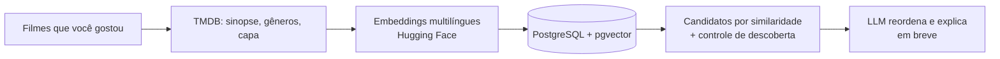

# 🎬 CineSense

**Recomendações de filmes que entendem clima, emoção e contexto, não só gênero e nota.**

Sistemas de recomendação tradicionais olham metadados (gênero, nota, popularidade) e
têm dificuldade com o que realmente faz alguém gostar de um filme: a *sensação* que ele
passa. O CineSense combina **embeddings semânticos**, **opinião do público** e **LLMs**
para sugerir filmes, incluindo lançamentos e títulos pouco conhecidos, e explicar
por que cada um combina com você.

> Nasceu de um problema real: eu vivo recomendando filmes para a minha mãe
> (suspense/crime), e eu mesmo gosto de monstros e aliens.

## Como funciona



1. **Entender os filmes:** cada sinopse vira um vetor de significado
   (`intfloat/multilingual-e5-small`). Assim, "criatura caçando a tripulação" fica
   perto de "alienígena isolado na nave", mesmo sem palavras em comum.
2. **Buscar candidatos:** o perfil do usuário (média dos filmes curtidos) é comparado
   com o catálogo no **pgvector**. O controle **Descoberta** penaliza filmes populares
   para revelar títulos desconhecidos.
3. **Refinar com LLM** *(próxima versão)*: reordenar considerando clima e emoção e
   explicar cada sugestão, sem spoilers.

## Roadmap

- [x] **V1:** busca na TMDB, embeddings, pgvector, controle de descoberta, interface Streamlit
- [ ] **V1.5:** LLM reordena e explica cada recomendação
- [ ] **V2:** resumo por aspectos da opinião do público (efeitos, tensão, ritmo, violência),
      sem spoilers e em cache, mais níveis de custo *Rápido / Equilibrado*
- [ ] **V3:** pesquisa opcional na web (nível *Profundo*), CLIP nas capas, perfis, onde assistir no Brasil
- [ ] **Avaliação offline** com MovieLens: medir se o LLM melhora as recomendações
- [ ] Demo pública com **"traga sua chave"** (a chave nunca é armazenada)

## Stack

Python · Streamlit (só interface) · PostgreSQL + pgvector · sentence-transformers
(Hugging Face) · TMDB API · Docker · pytest

## Rodando localmente

Pré-requisitos: Python 3.12+, Docker e uma chave gratuita da
[TMDB](https://www.themoviedb.org/settings/api).

```bash
cp .env.example .env          # e preencha TMDB_TOKEN
docker compose up -d          # PostgreSQL + pgvector na porta 5433
python -m venv .venv
.venv/Scripts/pip install -r requirements-dev.txt   # Linux/Mac: .venv/bin/pip
.venv/Scripts/python -m streamlit run app.py
```

Testes:

```bash
.venv/Scripts/python -m pytest
```

## Estrutura

```
recomendador/
  tmdb.py         cliente da API da TMDB (busca, detalhes, lançamentos, avaliações)
  embeddings.py   embeddings das sinopses (Hugging Face)
  db.py           armazenamento e busca vetorial (pgvector)
  recommender.py  perfil do usuário, candidatos e controle de descoberta
app.py            interface Streamlit (sem lógica de negócio)
tests/            testes unitários com TMDB simulada
```

## Licença

[MIT](LICENSE) © 2026 Luan Robert

---

Dados de filmes fornecidos pela [TMDB](https://www.themoviedb.org/). Este produto usa a
API da TMDB, mas não é endossado nem certificado pela TMDB.
